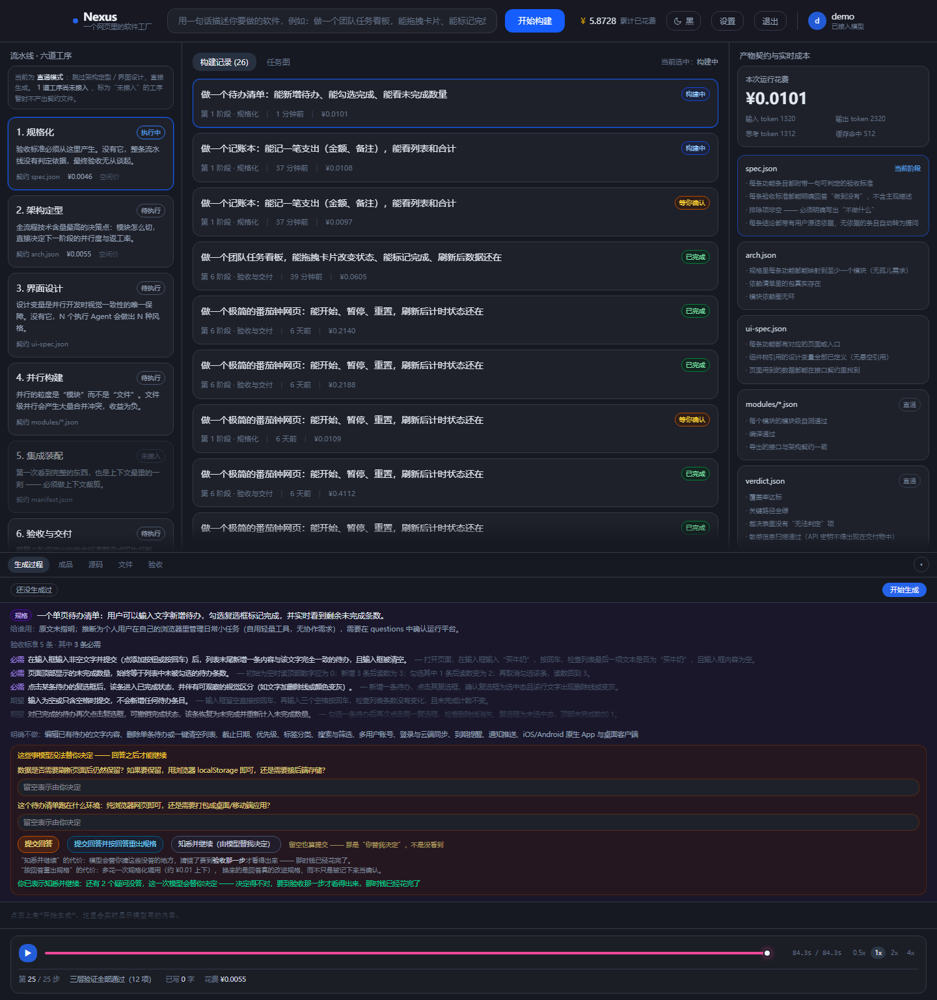

# 源码

```
源码/
├─ docs/        契约与设计文档（接口 / 目录 / 数据库）
├─ frontend/    Next.js 16 + React 19（当前可运行版本）
├─ backend/     FastAPI + MySQL 8（迁移中）
└─ database/    MySQL 建表脚本
```

## 现在是什么状态

**前端是能跑的完整版本**：说一句需求 → 六道工序 → 可下载的单文件网页。
**后端在逐步接管**：健康检查、统一错误信封、领域模型、事件层、认证业务层与测试
已经就位；HTTP 端点、数据库读写、工序编排按契约书附录 A 的六刀顺序往下搬。

| 能力 | 前端（Next + SQLite） | 后端（FastAPI + MySQL） |
|---|---|---|
| 页面与画布 | ✅ 全部 | — |
| API 客户端 / 事件流封装 | ✅ `src/api/`（类型由后端生成） | — |
| 健康检查 | — | ✅ `/api/v1/health`（真库 `db: ok`） |
| 错误信封 | 部分（见下） | ✅ AppError + 框架异常统一 |
| 领域模型 | `core/domain`（TS） | ✅ `app/domain`（Pydantic，含 14 种事件） |
| 认证 | ✅ 在用（Server Action） | ✅ 4 个端点 + MySQL repo + 10 条集成测试 |
| 运行 / 工序 / 产物 | ✅ 单文件全流程 | ⏳ 编排仍在 Next（明确的过渡债） |
| **全栈模式**（`FULLSTACK_MODE=on`） | ✅ 生成 db/api/web 三份产物 + 起容器 + 三层验证 | ✅ 建库 / 起容器 / 验证 / 回收 |

三份契约先于代码存在，就是为了让这个替换过程不返工：

| 文档 | 管什么 |
|---|---|
| [`docs/03-前后端分离契约书.md`](docs/03-前后端分离契约书.md) | 接口：请求/响应/错误码/SSE 帧/事件字段 |
| [`docs/04-目录结构.md`](docs/04-目录结构.md) | 位置：文件放哪、谁能 import 谁 |
| [`docs/05-数据库契约.md`](docs/05-数据库契约.md) | 存储：表结构、什么进库什么不进库 |

文档总索引见 [`docs/README.md`](docs/README.md)。

## 跑起来

### 前端（当前功能都在这里）

```bash
cd frontend
npm install
cp .env.example .env.local     # 填 DEEPSEEK_API_KEY；不填也能打开界面
npm run dev                    # http://localhost:3000
```

### 后端

```bash
cd backend
pip install -e ".[dev]"
cp .env.example .env
alembic upgrade head           # 需要 MySQL 8；没有的话只能跑测试
uvicorn app.main:app --reload  # http://127.0.0.1:8000/api/v1/health
```

### 三个进程一起（MySQL + 后端 + 前端）

```bash
docker compose up -d
docker compose exec backend alembic upgrade head
# 前端 http://localhost:3000 · 后端 http://localhost:8000/api/v1/health
```

## 两端契约怎么保持一致

后端 Pydantic 是唯一来源，前端的类型是**生成**的，不是手写的：

```bash
cd backend  && python -m tools.export_openapi openapi.json
cd frontend && npm run gen:types      # → src/api/generated/
cd frontend && npm run verify:types   # 生成物必须与提交一致
```

前端发请求只走 `src/api/client.ts`（错误信封在那里解析一次），
事件流只走 `src/api/sse.ts`（未知 kind 统一忽略）。

## 全栈模式怎么开

默认关闭，关闭时行为与老版本完全一致。打开需要三样东西：

1. **Docker**（推荐，有隔离）；没有 Docker 的开发机可以退一步用进程版：
   `backend/.env` 里写 `RUNTIME_RUNNER=process`，产物后端会作为本机进程起，
   接口与验证流程完全一致 —— 代价是**没有隔离**，只适合在本机演示自己刚生成的代码
2. 按 `database/README.md` 建好 `nexus_provisioner` 与 `nexus_product` 两个 MySQL 账号
3. 两端 `.env` 里把工作区指向**同一个绝对目录**：

```bash
# backend/.env
INTERNAL_TOKEN=<任意一串>
MYSQL_PROVISIONER_URL=mysql+pymysql://nexus_provisioner:<密码>@127.0.0.1:3306/?charset=utf8mb4
MYSQL_PRODUCT_URL=mysql+pymysql://nexus_product:<密码>@host.docker.internal:3306
RUNTIME_WORKSPACE_DIR=<与前端 WORKSPACE_ROOT 相同的绝对路径>

# frontend/.env.local
FULLSTACK_MODE=on
RUNTIME_URL=http://127.0.0.1:8000
INTERNAL_TOKEN=<与后端一致>
WORKSPACE_ROOT=<同一个绝对路径>
```

打开后一次生成会产出 `db/schema.sql`、`api/main.py`、`web/index.html`，然后：

```
建库 → 执行建表脚本 → 起容器 → 等 /health → 三层验证（数据库 / 接口 / 界面）
```

界面上：工作台多出「文件」与「验收」两个标签，清单里构建工序下多出
「数据库 / 后端 / 前端」三个子任务。

跑通之后，工作台会多出「文件」与「验收」两个标签，预览地址可以直接打开产物页面。



> 两条运行器都不可用时（没 Docker 且没开进程版），全栈模式会在"起服务"这一步停下并说明原因；
> 前面三段生成照常落盘，产物仍可下载。

## 验证

```bash
cd frontend && npm run verify         # typecheck + lint + test + build
cd frontend && npm run e2e:auth       # 端到端（需要 dev 已启动）
cd backend  && pytest                 # 57 个用例
cd backend  && ruff check . && lint-imports
```

## 两处约定，别踩

- **`frontend/src/core/` 是过渡态**：终局只有 `core/canvas` 留在前端，其余逐刀迁后端。
  在那之前不要把新逻辑写进 `core/`，否则它得跟着一起搬。
- **e2e 暂时在 `frontend/src/scripts/`**：它们要 import 前端 fixtures 直接造数据；
  等后端切换完成、变成纯黑盒（只走 HTTP）之后再搬到仓库根 `scripts/`。